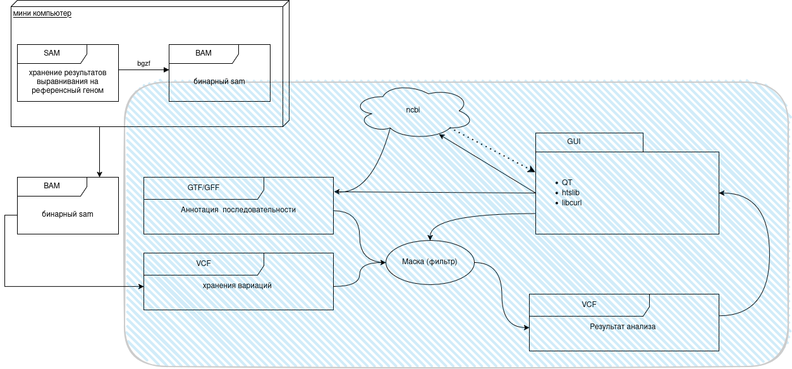

# Установка
### Загрузить зависимости
```bash
sudo apt install git cmake g++ qt6-base-dev qt6-declarative-dev libcurl4-openssl-dev libcurl4-openssl-dev libhts3t64 libhts-dev tabix
```
### Загрузка исходников
```bash
git clone https://github.com/furanocoumarins/GCAT 
```
### Сборка
```bash
cmake . && make && make install
```
# Зависимости (ubuntu packages)
* qt6-base-dev qt6-declarative-dev
* libcurl4-openssl-dev
* libhts3t64 libhts-dev tabix
